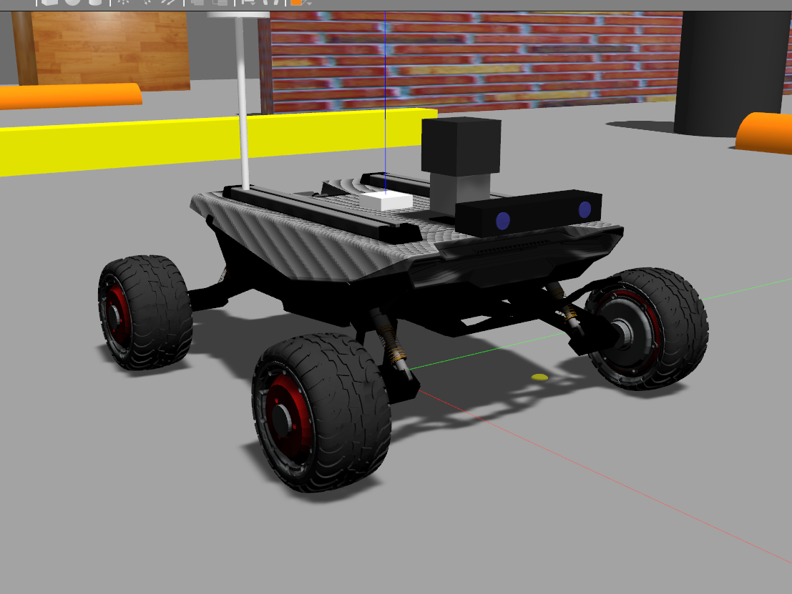
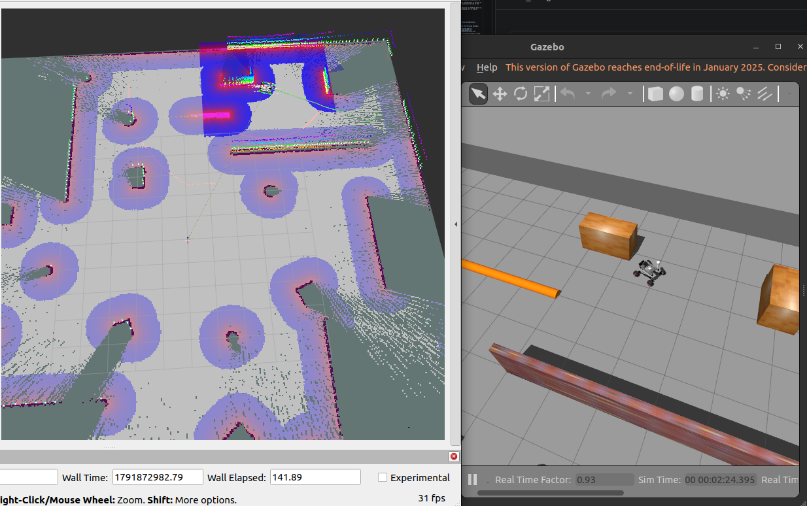
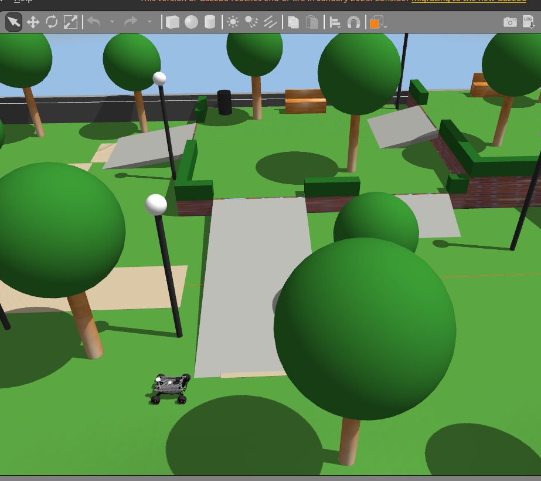
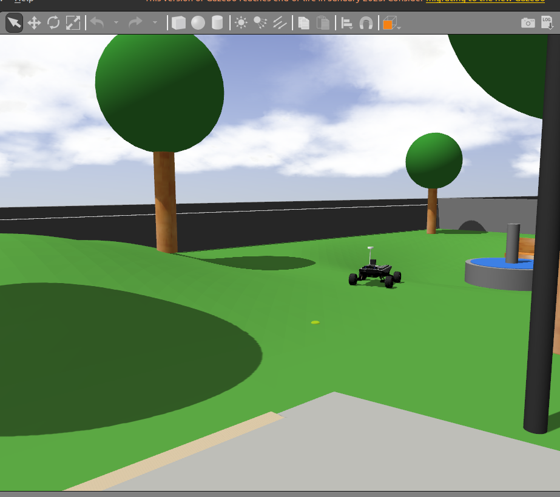

# Scout Mini Simulator

AgileX Scout Mini simulation for ROS 2 Humble and Gazebo 11 (Classic). The Scout Mini model here has a Livox Mid-360 and a ZED 2i, in place of the default 2D lidar. It works with SLAM, Nav2 and frontier exploration, and comes with an obstacle arena and a park world with hills and ramps to test it in.

<p align="center">
  
</p>

## Contents

| Path | Description |
| -- | -- |
| `overlay/ugv_gazebo_sim/` | Our changes to [ugv_gazebo_sim](https://github.com/ROSETEA-lab/ugv_gazebo_sim): Scout Mini model with Livox and ZED 2i, worlds, launch files. `setup.sh` applies them. |
| `src/scout_navigation` | Nav2, slam_toolbox and EKF configuration, plus the `cloud_height_filter` node that feeds the 3D clouds to Nav2 |
| `src/ha_frontier_explorer` | Frontier-based autonomous exploration |
| `setup.sh` | Clones upstream `ugv_gazebo_sim` and copies the overlay on top |
| [`CHANGES.md`](CHANGES.md) | Every change we made to the upstream files |

## Installation

Tested on **Ubuntu 22.04 + ROS 2 Humble + Gazebo Classic 11**.

### 1. Install the dependencies

```bash
sudo apt update
sudo apt install ros-humble-desktop ros-humble-gazebo-ros-pkgs \
    ros-humble-navigation2 ros-humble-nav2-bringup ros-humble-slam-toolbox \
    ros-humble-robot-localization ros-humble-pointcloud-to-laserscan \
    ros-humble-topic-tools ros-humble-teleop-twist-keyboard \
    ros-humble-xacro ros-humble-rmw-cyclonedds-cpp \
    python3-colcon-common-extensions python3-rosdep libasio-dev
```

### 2. Clone and set up

```bash
git clone https://github.com/dwiwekan/scout_mini_simulator.git
cd scout_mini_simulator
./setup.sh
```

`setup.sh` downloads [ugv_gazebo_sim](https://github.com/ROSETEA-lab/ugv_gazebo_sim) into `src/` (at the commit we tested) and copies our changed files over it. For the **real robot**, run `./setup.sh --real-robot`. That also clones [ugv_sdk](https://github.com/agilexrobotics/ugv_sdk) and [scout_ros2](https://github.com/ROSETEA-lab/scout_ros2).

### 3. Build

```bash
rosdep install --from-paths src --ignore-src -r -y
colcon build --symlink-install
source install/setup.bash
```

> **Using Anaconda?** An active conda environment replaces the system Python, and ROS Python nodes then fail silently: the robot is never spawned. Run `conda deactivate`, or `conda config --set auto_activate_base false`, before building and running.

## Usage

Run each command in its own terminal, after `source install/setup.bash`.

### 1. Simulation

```bash
# Obstacle arena + park (default world), with RViz
ros2 launch scout_gazebo_sim scout_mini_empty_world.launch.py publish_odom_tf:=true

# Start in the park instead of the arena
ros2 launch scout_gazebo_sim scout_mini_empty_world.launch.py publish_odom_tf:=true x_pose:=12.0

# Rough terrain world
ros2 launch scout_gazebo_sim scout_mini_empty_world.launch.py publish_odom_tf:=true \
    world_name:=rough_terrain_40m.world z_pose:=1.8
```

Drive the robot with the keyboard:

```bash
ros2 run teleop_twist_keyboard teleop_twist_keyboard --ros-args -r cmd_vel:=/scout_mini/cmd_vel
```

| Parameter | Default | Description |
| -- | -- | -- |
| `world_name` | `empty.world` | World file in `scout_gazebo_sim/worlds` |
| `publish_odom_tf` | `false` | Gazebo publishes the `odom → base_link` TF. Set it to `true` when you don't run the EKF. |
| `use_rviz` | `true` | Start RViz |
| `x_pose`, `z_pose` | `0.0`, `0.245` | Spawn position |

### 2. SLAM (mapping while you drive)

```bash
ros2 launch scout_navigation slam_online_async.launch.py namespace:=scout_mini
```

### 3. Autonomous exploration (SLAM + Nav2 + frontier explorer)

Start the simulation (step 1), then:

```bash
ros2 launch ha_frontier_explorer explore_scout_mini.launch.py use_ekf:=false
```

The robot drives to the nearest unexplored frontier, again and again, until the map is complete. A goal that fails or takes more than 60 s is blacklisted.

### 4. Sensor topics

All topics are in the `/scout_mini` namespace.

| Sensor | Topic | Type | Frame |
| -- | -- | -- | -- |
| Livox Mid-360 | `livox/lidar` | `sensor_msgs/PointCloud2` | `livox_frame` |
| 2D scan from the Livox | `scan` | `sensor_msgs/LaserScan` | `livox_frame` |
| ZED 2i, left image | `zed/zed/left/image_rect_color` | `sensor_msgs/Image` | `zed_left_camera_optical_frame` |
| ZED 2i, depth | `zed/zed/depth/depth_registered` | `sensor_msgs/Image` | `zed_left_camera_optical_frame` |
| ZED 2i, camera info | `zed/zed/depth/camera_info` | `sensor_msgs/CameraInfo` | `zed_left_camera_optical_frame` |
| ZED 2i, point cloud | `zed/zed/point_cloud/cloud_registered` | `sensor_msgs/PointCloud2` | `zed_left_camera_optical_frame` |
| ZED 2i, IMU | `zed/zed/imu/data` | `sensor_msgs/Imu` | `zed_imu_link` |
| Obstacle clouds for Nav2 | `livox/obstacles`, `zed/obstacles` | `sensor_msgs/PointCloud2` | sensor frame |

### 5. Customizing the world

The arena and park are generated by a script. Edit the lists in [`tools/gen_empty_world.py`](overlay/ugv_gazebo_sim/scout/scout_gazebo_sim/tools/gen_empty_world.py) (terrain, ramps, trees and so on), then regenerate:

```bash
cd overlay/ugv_gazebo_sim/scout/scout_gazebo_sim
python3 tools/gen_empty_world.py worlds/empty.world
cd - && ./setup.sh && colcon build --packages-select scout_gazebo_sim
```

If you work on the files a lot, run `./setup.sh --link` once. It symlinks the overlay files into `src/`, so your edits go straight into `overlay/`.

## Known issues

- **The ZED image or cloud doesn't arrive in RViz.** With Cyclone DDS and the default Linux socket buffer, large messages never reach *best effort* subscribers. Set the RViz display's reliability to *Reliable*, or raise the buffer:
  ```bash
  sudo sysctl -w net.core.rmem_max=2147483647
  ```
- **The `ekf_node` crashes with `libdiagnostic_updater.so` missing.** Your `ros-humble-diagnostic-updater` package is outdated. Upgrade it with `sudo apt install --only-upgrade ros-humble-diagnostic-updater`. Until then, use `publish_odom_tf:=true` and `use_ekf:=false` as shown above.
- **Nav2 treats slopes as obstacles.** The obstacle filter works by height, so the explorer avoids ramps and hills. You can still drive over them with teleop.
- **Performance.** The Livox is simulated with 360 × 16 CPU rays to keep the simulation near real time: about 0.95× in the arena and 0.87× in the park.

## FAQ

**How do I simulate the AgileX Scout Mini in Gazebo with ROS 2?**
Follow [Installation](#installation), then run `ros2 launch scout_gazebo_sim scout_mini_empty_world.launch.py publish_odom_tf:=true`.

**Does it work with the original Scout Mini model (2D lidar)?**
Upstream `ugv_gazebo_sim` has that model. This repo replaces its lidar with a Livox Mid-360 and adds a ZED 2i. The `scan` topic is still there (made from the Livox cloud), so 2D SLAM packages work unchanged.

**Can I use it with Gazebo Harmonic / Ignition, or ROS 2 Jazzy?**
Not yet. It is only tested on ROS 2 Humble with Gazebo Classic 11.

**Can I add my own sensors or worlds?**
Yes. The model is `overlay/ugv_gazebo_sim/scout/scout_gazebo_sim/models/scout_mini/scout_mini.sdf`, and the worlds are in `worlds/` next to it. Pass yours with `world_name:=`.

## Gallery

<p align="center">
  
  <br><em>Autonomous exploration in the obstacle arena: slam_toolbox map and Nav2 costmap (RViz, left) and Gazebo (right)</em>
</p>

<p align="center">
  
  
  <br><em>The park: terraces with 5°–25° ramps (left), and hills with the sunken plaza and its fountain (right)</em>
</p>

## Credits

This work builds on these open-source projects:

- [ROSETEA-lab/ugv_gazebo_sim](https://github.com/ROSETEA-lab/ugv_gazebo_sim): ROS 2 port of the AgileX Gazebo simulation, which the Scout Mini model and launch files come from. Originally from [agilexrobotics/ugv_gazebo_sim](https://github.com/agilexrobotics/ugv_gazebo_sim).
- [mattiadutto/scout_navigation](https://github.com/mattiadutto/scout_navigation): Nav2, slam_toolbox and robot_localization setup for the Scout Mini.
- [agilexrobotics/ugv_sdk](https://github.com/agilexrobotics/ugv_sdk) and [ROSETEA-lab/scout_ros2](https://github.com/ROSETEA-lab/scout_ros2): AgileX drivers for the real robot.
- [Livox Mid-360](https://www.livoxtech.com/mid-360) and [Stereolabs ZED 2i](https://www.stereolabs.com/products/zed-2i): sensor specifications used for the simulated models.

**This repository's changes** (details in [CHANGES.md](CHANGES.md)):
- Livox Mid-360 and ZED 2i on the Scout Mini model.
- `pointcloud_to_laserscan` integration.
- The `cloud_height_filter` node and the Nav2 voxel layer configuration.
- slam_toolbox namespace fixes.
- The frontier explorer integration launch.
- The obstacle arena, the park world and its generator.
- Collision geometry and wheel friction changes so the model runs at real-time speed.

## License

Apache 2.0, see [LICENSE](LICENSE). `src/scout_navigation` is Apache 2.0 from upstream. The files in `overlay/` are modified from ugv_gazebo_sim, which has no license file. Keep the original authors' credits when you reuse them.
